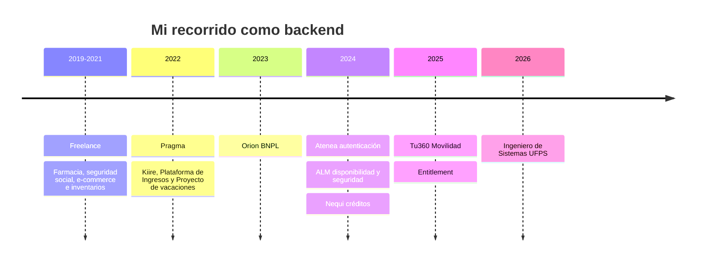
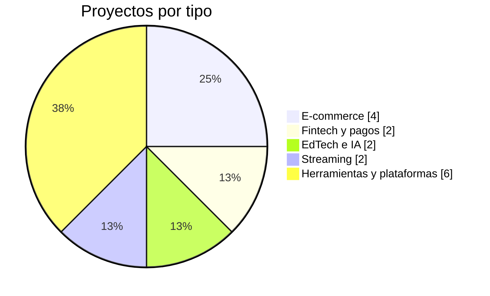

<div align="center">

[](https://git.io/typing-svg)


[](https://aws.amazon.com/certification/certified-cloud-practitioner/)

[](https://www.pragma.com.co/)
[](https://github.com/AndreyRivera13)

</div>

---

## 🧑‍💻 Perfil profesional

Ingeniero de sistemas con cerca de **6 años de experiencia** como desarrollador backend (2 freelance y 4 en **Pragma**) en **Java y Spring Boot** para banca digital, retail y fintech. En **Bancolombia**, a través de Pragma, he pasado por seis equipos (**BNPL, autenticación, ALM, Nequi, Tu360 Movilidad y Entitlement**), lo que me da una mirada de punta a punta: microservicios reactivos, arquitectura limpia, eventos con RabbitMQ, caché con Redis, AWS, pruebas y seguridad. Busco crecer como referente técnico acompañando el ciclo de vida completo del software.

- 📍 Cúcuta, Colombia
- 🗣️ Español nativo · Inglés B1
- ☁️ Certificación AWS Cloud Practitioner

```java
public class Brayam extends BackendDeveloper {

    String ubicacion   = "Cúcuta, Colombia 🇨🇴";
    int    experiencia = 6; // 2 freelance + 4 en Pragma
    String cliente     = "Bancolombia";
    List<String> equipos = List.of("BNPL", "Autenticación", "ALM", "Nequi", "Tu360 Movilidad", "Entitlement");

    Mono<String> stack() {
        return Mono.just("Java 21 · Spring WebFlux · RabbitMQ · Redis · AWS");
    }

    String meta() { return "Crecer como referente técnico 🚀"; }
}
```

---

## 🛠️ Stack

<div align="center">


<br><br>


<br><br>


<br>


<br>


<br>


<br>


</div>

<details>
<summary><b>🧰 Habilidades técnicas completas</b></summary>

<br>

| Área | Herramientas |
|---|---|
| Lenguajes | Java 21, TypeScript, Python, Node.js, Kotlin, PHP, Elixir |
| Frameworks | Spring Boot, Spring WebFlux, Spring Web (MVC), R2DBC, NestJS |
| Arquitectura | Clean Architecture, Hexagonal, Microservicios, CQRS, EDA, POO, SOLID |
| Datos y caché | PostgreSQL (Aurora), DynamoDB, MySQL, MongoDB, Redis, Caffeine |
| Mensajería y eventos | RabbitMQ (CloudEvents, AsyncAPI), Kafka |
| Testing | JUnit, Mockito, JaCoCo, StepVerifier, Karate, Pitest (mutation) |
| Cloud y DevOps | AWS (Aurora, DynamoDB, S3, Secrets Manager, EC2), Kubernetes, Docker, Azure DevOps (pipelines), SonarQube, Jenkins |
| Observabilidad y seguridad | Dynatrace, logs estructurados ECS, JWT, gestión de vulnerabilidades |
| Control de versiones | Git, GitHub, GitLab, Azure DevOps |
| Metodologías | Scrum |

</details>

---

## 💼 Experiencia



### 🏦 Desarrollador Backend Java · Pragma S.A., Colombia
`Sep 2022 - Actualidad` · Proveedor de Bancolombia (EVC Gestión del fraude, Distribución, Ecosistemas)

**🔑 Entitlement, autorizaciones y accesos de clientes** · `Sep 2025 - Actualidad`
- Microservicios reactivos en Java 21 y WebFlux con arquitectura limpia, CQRS sobre PostgreSQL (Aurora) con lectura y escritura separadas, eventos con RabbitMQ y caché con Redis.
- Migré `ms_actors` a Spring Boot 4 y Jackson 3 para cerrar vulnerabilidades, y corregí 12 entidades R2DBC que el nuevo driver de Postgres dejó al descubierto; validado en DEV.
- Implementé en dos microservicios el registro de publicación de eventos con DynamoDB (patrón DB Inbox): se guarda, se publica y se actualiza el estado para poder reintentar.
- Resolví el consumo excesivo de memoria de `client_parameters_ms` acotando la caché Caffeine y unificando el ObjectMapper.
- Redirigí el consumo del servicio de datos personales de MDM con credenciales por perfil, fuera del código.
- Librería ECS de logs estructurados (Java y Elixir): corregí bugs, actualicé dependencias por vulnerabilidades, unifiqué los repositorios de Azure DevOps y GitHub y gestioné su publicación en Maven Central.

**🚌 Tu360 Movilidad, Ruta 360** · `Abr - Sep 2025`
- Construí el control de ruta crítica que detiene el despliegue de microservicios si fallan los flujos de aceptación (módulos Cotidianidad, Movilidad y Pública).
- Atendí vulnerabilidades de dependencias en lambdas de Movilidad y de Gestión de Clientes.

**💜 Nequi, consulta de créditos de Bancolombia** · `Dic 2024 - Mar 2025`
- Desarrollé el componente adaptador que permite a Nequi consultar los créditos activos de un cliente y el detalle de cada crédito (servicios `retrieve-customer-loans` y `loan-details`).
- Acompañé las pruebas de performance y la salida a producción, y resolví fallas de Sonar y de VPN en los pipelines de build.

**🛡️ ALM, disponibilidad y seguridad** · `Abr - Nov 2024`
- Cerré vulnerabilidades del regulatorio C1 2024 en varios microservicios y migré uno a Spring Boot 3 y Java 17.
- Generé el certificado público para consumir APIs en producción; adopté el ALM Template, configuré pruebas de mutación y revisé métricas y alertas en Dynatrace.
- Gestioné con el equipo de plataformas la actualización de PostgreSQL y retiré lambdas, repositorios y despliegues sin uso.

**🔐 Atenea, autenticación de primer factor** · `Mar 2024`
- Adaptador con KMS en un microservicio en Elixir para cifrar las llaves privadas antes de almacenarlas.
- Migración de Grafana a Dynatrace y pruebas del nuevo proceso de creación de consumidores.

**🛒 Orion, BNPL** · `Feb 2023 - Feb 2024`
- Desarrollo de funciones de una lambda de transacciones (actualizar, consultar pendientes y rechazar), sus reglas de entrada en infraestructura y el ajuste de sus pruebas de aceptación.
- APIs de BNPL (purchase, terms, generate_document): caché con Redis, ajuste de mensajes de excepción, correcciones para Sonar y despliegues hasta producción.
- Pruebas de aceptación y documentación del control de ruta crítica, y capa de repositorio de un nuevo microservicio.

**📁 Proyectos previos en Pragma:** Kiire (Grupo Éxito y Pagos Redeban), Plataforma de Ingresos y Proyecto de vacaciones.
- Funcionalidades con programación reactiva en Java, arquitectura limpia y microservicios, con pruebas unitarias y de integración (JUnit, Mockito, JaCoCo).
- Versionamiento con Git sobre Amazon CodeCommit y bases de datos en Amazon RDS (PostgreSQL), según estándares Pragma.

### 💻 Desarrollador Backend Freelance
`Dic 2019 - Dic 2021` · Farmacia, afiliación a seguridad social, tiendas virtuales y control de inventario (detalle en Proyectos 👇)

## 🎓 Formación y certificaciones

- 🎓 **Ingeniería de Sistemas**, Universidad Francisco de Paula Santander · 2018 - 2026 · Graduado
- 📘 **Tecnólogo en Análisis y Desarrollo de Sistemas de Información**, SENA · 2021 - 2023
- 🗄️ **Tecnología en Implementación y Gestión de Bases de Datos**, SENA · Abr 2026 - En curso
- ☁️ **Certificación AWS Cloud Practitioner**, Amazon Web Services

---

## 🧩 Proyectos

<div align="center">


</div>



| Producto | Tipo | Qué hace | Stack |
|---|---|---|---|
| 👟 [**DRUTS**](https://github.com/AndreyRivera13/druts) | E-commerce | Tienda de calzado con variantes, inventario en tiempo real y ventas por canal social | Next.js · NestJS · PostgreSQL · Prisma / TypeORM · Docker |
| ☕ **Colombia Grand Reserve** | E-commerce | Café colombiano de especialidad con pagos en Stripe y analítica | Next.js · Supabase · Stripe |
| 💱 **Nuvix Bank** | Fintech | Cotización de divisas, billetera multimoneda, verificación KYC y backoffice con auditoría y reportes | Java · Spring Boot · Microservicios · Gradle |
| 💃 **Arte Viva** | Streaming | Streaming de danza y artes escénicas, con IA de postura en camino | React · NestJS · Kafka · Redis |
| 🎓 **Eltaryn** | EdTech | Laboratorios reales en la nube y tutor con IA para ingenieros | Docker · Kubernetes · AWS |
| ✨ **EduGuide AI** | EdTech · IA | Pipeline multiagente que genera guías educativas de hasta 30 páginas, exportables a DOCX, PDF y PPTX | Java 21 · Spring Boot · Next.js · PostgreSQL · Redis · RabbitMQ · AWS S3 |
| 🔴 **Afrodita** | Streaming | Transmisión en vivo con chat en tiempo real y propinas en tokens | Next.js · Socket.io · Prisma |
| ▦ [**Generador QR**](https://github.com/AndreyRivera13/generate-qr) | Herramienta | Códigos QR al instante, 100% en el navegador | HTML · JavaScript |
| 🏥 **Farmacia** | Freelance | Sistema de ventas e inventario | PHP · MySQL |
| 🩺 **Afiliación a seguridad social** | Freelance | Plataforma web de afiliación | Java Spring Boot · MySQL · Angular |
| 👞 **Tienda virtual de calzado** | Freelance | E-commerce a la medida | Java Web · MySQL |
| 📦 **Control de inventario** | Freelance | Aplicación de escritorio | Kotlin · SQLite |
| 🛍️ **Tienda virtual SOMAR** | Freelance | E-commerce | Node.js · MySQL |
| 💳 **Kiire** | Pragma | Proyecto para Grupo Éxito y Pagos Redeban con programación reactiva | Java · Microservicios · Amazon RDS |
| 📈 **Plataforma de Ingresos** | Pragma | Funcionalidades reactivas con arquitectura limpia | Java · PostgreSQL |
| 🏖️ **Proyecto de vacaciones** | Pragma | Funcionalidades reactivas con arquitectura limpia | Java · PostgreSQL |

---

## 🚀 Proyectos destacados

<div align="center">

<a href="https://github.com/AndreyRivera13/gitpilot"></a>
<a href="https://github.com/AndreyRivera13/distributed-rate-limiter"></a>
<a href="https://github.com/AndreyRivera13/banking-core-platform"></a>
<a href="https://github.com/AndreyRivera13/tech-content"></a>
<a href="https://github.com/AndreyRivera13/sat_wiki"></a>
<a href="https://github.com/AndreyRivera13/auth-service-challenge"></a>

</div>

| Proyecto | De qué va |
|---|---|
| 🖥️ [gitpilot](https://github.com/AndreyRivera13/gitpilot) | Cliente Git de escritorio para macOS con Electron + React y soporte para varias cuentas. |
| 🚦 [distributed-rate-limiter](https://github.com/AndreyRivera13/distributed-rate-limiter) | Controla cuántas peticiones hace cada cliente por unidad de tiempo en un entorno distribuido. |
| 🏦 [banking-core-platform](https://github.com/AndreyRivera13/banking-core-platform) | Plataforma de core bancario en Java. |
| 🌊 [sat_wiki](https://github.com/AndreyRivera13/sat_wiki) | Wiki del Sistema de Alertas Tempranas (SAT). |
| 🔐 [auth-service-challenge](https://github.com/AndreyRivera13/auth-service-challenge) | Servicio de autenticación en Elixir. |
| 📚 [tech-content](https://github.com/AndreyRivera13/tech-content) | Contenido tech diario. |

---

## 📊 Stats

<div align="center">


<br>


<br>


</div>

---

## 📫 Hablemos

<div align="center">

[](https://andreyri13.github.io/Curriculum/)
[](https://www.linkedin.com/in/brayam-andrey-oliveros-rivera-00a514200)
[](mailto:andreyrivera2018@gmail.com)
[](https://github.com/AndreyRivera13)

**¿Tienes un reto de backend interesante? Escríbeme, que me encanta resolverlos. ☕**

</div>


